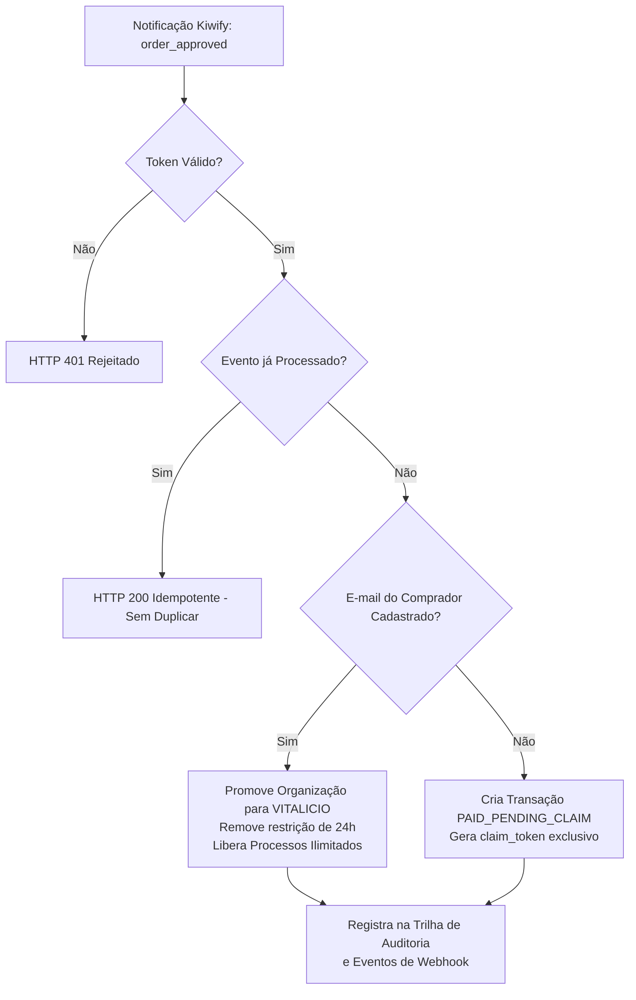

# Guia Operacional de Integração Kiwify — DocumentoCerto SaaS

Este documento é o guia definitivo e passo a passo para configuração, parametrização e conciliação do webhook da **Kiwify** com a plataforma **DocumentoCerto** em produção.

---

## 1. Visão Geral da Arquitetura Comercial

- **Aplicação de Produção:** `https://documentocerto-1.onrender.com`
- **Endpoint de Webhook:** `https://documentocerto-1.onrender.com/api/webhooks/kiwify`
- **Checkout Oficial Kiwify:** `https://pay.kiwify.com.br/ueLjXAd`
- **Modelo Comercial:** R$ 19,90 — Pagamento Único com Acesso Vitalício
- **Período de Experimentação:** 24 horas grátis sem necessidade de cartão

---

## 2. Passo a Passo no Painel da Kiwify

Para conectar as vendas da Kiwify à liberação automática de licenças no DocumentoCerto:

### Passo 2.1: Acessar a Seção de Webhooks
1. Faça login na sua conta da Kiwify: [https://dashboard.kiwify.com.br](https://dashboard.kiwify.com.br)
2. No menu lateral esquerdo, clique em **Apps** (ou **Configurações**) e selecione **Webhooks**.
3. Clique no botão **Criar Webhook** (ou **Novo Webhook**).

### Passo 2.2: Cadastrar o Webhook do DocumentoCerto
1. **Nome do Webhook:** `DocumentoCerto - Produção Render`
2. **URL do Webhook:**
   ```
   https://documentocerto-1.onrender.com/api/webhooks/kiwify
   ```
3. **Produto:** Selecione o produto correspondente ao DocumentoCerto (Plano Vitalício R$ 19,90) ou marque *Todos os produtos*.
4. **Eventos Obrigatórios a Selecionar:**
   - ✅ **Pedido aprovado / Compra aprovada (`order_approved`)** — Promove imediatamente a conta para o Plano Vitalício.
   - ✅ **Reembolso (`refunded`)** — Revoga o acesso vitalício caso o cliente cancele a compra.
   - ✅ **Chargeback (`chargedback`)** — Bloqueia a licença em caso de contestação financeira.
5. **Token Secreto (Assinatura):**
   - A Kiwify disponibilizará um campo de **Token do Webhook** (ou gerará uma chave de verificação).
   - Copie esse token para utilizá-lo no Render.

---

## 3. Parametrização no Painel do Render (Produção 24/7)

Para que o backend do DocumentoCerto valide com segurança criptográfica que as notificações vieram exclusivamente dos servidores da Kiwify:

1. Acesse o painel do Render: [https://dashboard.render.com](https://dashboard.render.com)
2. Clique no Web Service **`documentocerto`** (ou `documentocerto-1`).
3. No menu lateral, clique na aba **Environment**.
4. Localize a variável **`KIWIFY_WEBHOOK_TOKEN`** (ou clique em **Add Environment Variable**):
   - **Key:** `KIWIFY_WEBHOOK_TOKEN`
   - **Value:** Cole o token obtido no painel da Kiwify.
5. Clique em **Save Changes**. O Render aplicará a variável e reiniciará a aplicação em poucos segundos com zero downtime.

> [!IMPORTANT]
> **Segurança Estrita Ativa:** O servidor rejeita com **HTTP 401 (`UNAUTHORIZED_WEBHOOK`)** qualquer requisição que não contenha o token correspondente nos cabeçalhos (`x-kiwify-token` / `x-webhook-token`), parâmetros de busca (`?token=...`), Bearer token ou corpo da requisição.

---

## 4. Fluxos de Conciliação Automática de Vendas

O DocumentoCerto implementa um motor de conciliação resiliente de 3 vias na tabela relacional `kiwify_transactions`:



### Cenário 1: E-mail da Compra Igual ao E-mail Cadastrado
- **Comportamento:** O sistema identifica o usuário instantaneamente pelo e-mail (`Customer.email`).
- **Ação:** A organização do usuário é imediatamente atualizada:
  - `plano`: `'VITALICIO'`
  - `trialAtivo`: `false`
  - `trialExpiraEm`: `null` (acesso permanente sem data limite)
  - `limiteProcessosMes`: `999999` (ilimitado)
- **Auditoria:** Uma entrada formal é gravada na tabela `audit_logs` com a ação `KIWIFY_ORDER_APPROVED`.

### Cenário 2: Compra com E-mail Diferente (Resgate Seguro via Claim Token)
- **Problema:** Um cliente compra com seu e-mail pessoal no checkout da Kiwify, mas quer usar a ferramenta com seu e-mail corporativo.
- **Solução Nativa:**
  1. O sistema registra a compra aprovada na tabela `kiwify_transactions` com status `PAID_PENDING_CLAIM`.
  2. É gerado um `claim_token` criptográfico seguro de 48 caracteres.
  3. O usuário pode associar a licença a qualquer momento através do endpoint:
     ```http
     POST /api/plans/claim-purchase
     Authorization: Bearer <TOKEN_DO_USUARIO>
     Content-Type: application/json

     {
       "claimToken": "<CLAIM_TOKEN_RECEBIDO>"
     }
     ```
     *(Ou informando o ID do pedido da Kiwify `orderId` e e-mail de compra).*
  4. A organização autenticada é imediatamente convertida para o Plano Vitalício.

### Cenário 3: Estorno ou Contestação (`refunded` / `chargedback`)
- **Comportamento:** A Kiwify notifica a devolução do pagamento.
- **Ação:** O DocumentoCerto localiza a transação original e a organização associada, revertendo o plano para `GRATIS` e suspendendo os privilégios vitalícios de forma auditada.

---

## 5. Idempotência e Proteção contra Retentativas

A Kiwify pode enviar o mesmo evento múltiplas vezes em caso de lentidão transitória na rede.

1. Toda notificação processada com sucesso é armazenada na tabela `kiwify_webhook_events` com restrição de unicidade composta:
   ```sql
   CONSTRAINT unq_kiwify_order_event UNIQUE (order_id, event_type)
   ```
2. Caso a Kiwify reenvie o evento para o mesmo pedido, o DocumentoCerto reconhece a duplicidade e responde imediatamente com **HTTP 200** (`idempotente: true`), evitando reprocessamentos ou inconsistências de dados.

---

## 6. Simulação e Testes de Homologação

Você pode testar a integração via terminal usando `curl` ou PowerShell:

### Teste de Rejeição de Chamada Desprotegida (Deve retornar 401):
```bash
curl -X POST https://documentocerto-1.onrender.com/api/webhooks/kiwify \
  -H "Content-Type: application/json" \
  -d '{"order_id": "teste_fake_123", "order_status": "paid"}'
```
*Resposta esperada:* `HTTP 401 Unauthorized`

### Teste de Ativação Autorizada (Simulação de Compra Real):
```bash
curl -X POST "https://documentocerto-1.onrender.com/api/webhooks/kiwify?token=SEU_TOKEN_AQUI" \
  -H "Content-Type: application/json" \
  -d '{
    "order_id": "kw_simulacao_999",
    "order_status": "paid",
    "Customer": {
      "email": "usuario@suaempresa.com",
      "full_name": "Nome do Cliente"
    },
    "Product": {
      "product_name": "DocumentoCerto Plano Vitalicio"
    },
    "charge_amount": "19.90",
    "payment_method": "pix"
  }'
```
*Resposta esperada:* `HTTP 200 OK` com confirmação de ativação do Plano Vitalício.

---

## 7. Monitoramento de Vendas e Conversão

O gestor da plataforma pode acompanhar em tempo real todas as ativações, receita acumulada e transações pendentes de resgate no **Dashboard de Métricas & Analytics**:
- **Acesso Visual:** Clique no botão **Analytics & Funil** no menu superior interno do app.
- **Acesso via API:** `GET /api/admin/metrics` enviando o cabeçalho `x-admin-key: <ADMIN_KEY>`.
